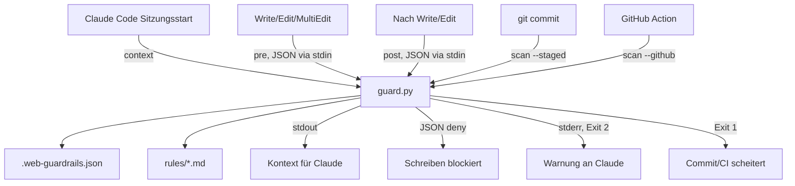
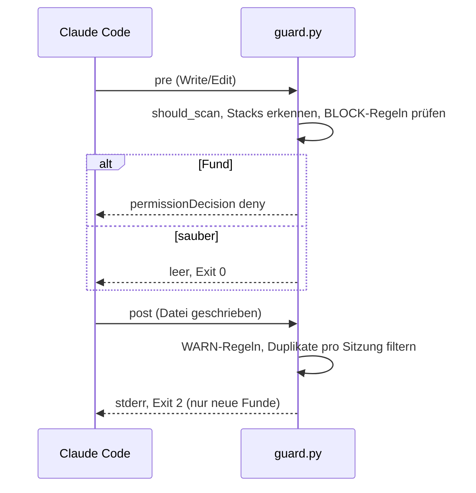

# Architektur

[← Zurück zur README](../README.md)

## Überblick

web-guardrails besteht aus einem zentralen, abhängigkeitsfreien Python-Skript (`guard.py`), das über verschiedene Einstiegspunkte genutzt wird: Claude-Code-Hooks, Git-pre-commit-Hook, pre-commit-Framework, GitHub Action und manuelle CLI.

## Komponenten

| Komponente | Pfad | Aufgabe |
|---|---|---|
| Guard-Skript | `plugins/web-guardrails/scripts/guard.py` | Regelwerk (`RULES`), Stack-Erkennung, Scan, Hook-Modi |
| Hook-Definition | `plugins/web-guardrails/hooks/hooks.json` | verbindet Claude-Code-Ereignisse mit `guard.py` (Inhalt nicht eingesehen, Annahme) |
| Regeltexte | `plugins/web-guardrails/rules/*.md` | Projektkonventionen, die beim Sitzungsstart in den Kontext geladen werden |
| Skills | `plugins/web-guardrails/skills/init`, `dsgvo-check` | Projekt-Setup und Browser-Messung |
| Templates | `plugins/web-guardrails/templates/` | Vorlagen für Workflow, pre-commit, Security-Patterns, Guidance, Lizenzliste |
| GitHub Action | `action.yml` | Composite Action, ruft `guard.py scan --github` auf |
| Tests | `tests/` | `unittest`-Suite mit Fixtures |

## Regel-Engine

Jede Regel ist ein Tupel aus ID, Stufe (`block`/`warn`), Pack (`common`, `php`, `wordpress`), Regex und Hinweistext. Die Prüfung läuft zeilenweise. Zeilen mit `dsgvo-ok` oder einem Host aus `allow_hosts` werden übersprungen; Regeln aus `disable_rules` sind abgeschaltet.

## Datenfluss

## Wichtige Designentscheidungen

- **Fail-open bei defekter Eingabe:** Ungültiges JSON auf stdin führt zu Exit 0, die Sitzung wird nie blockiert.
- **Einmalige Warnungen:** `post` speichert gemeldete Funde pro Sitzung in einer temporären Datei (`web-guardrails-<hash>.json` im Temp-Verzeichnis, Hash aus der Session-ID).
- **Gestagter Inhalt:** `scan --staged` liest per `git show :<pfad>` den Index, nicht den Working Tree.
- **Stack-Erkennung:** Verzeichnisbaum bis Tiefe 3 (WordPress: `wp-config.php`, `wp-content/`, `theme.json`, `Theme Name:` in `style.css`, `Plugin Name:` im Header, Composer-Pakete) oder Override per Konfiguration.
- **Git-Hook-Installation:** Kopiert das Plugin-Verzeichnis (ohne `templates`, `skills`, `hooks`) nach `<git-hooks>/web-guardrails` und schreibt ein `pre-commit`-Skript; ein fremder Hook wird nicht überschrieben (Ausweichdatei `pre-commit.web-guardrails`).
